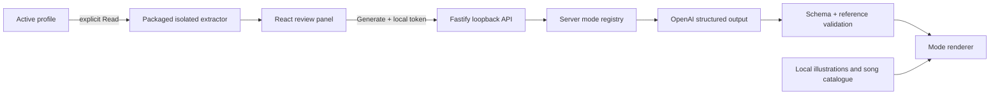

# Architecture

## Ownership

- `packages/contracts`: bounded input/result schemas, shared types, text redaction, obvious eligibility signals.
- `packages/catalogues`: asset/palette/song IDs. Model output can select only known IDs; UI resolves actual paths and music links.
- `apps/extension/src/extraction`: conservative rendered-text capture. The unlisted entrypoint is injected only after an explicit user action.
- `apps/extension/entrypoints/extract.ts`: capture identity listener, scoped to one snapshot and cleaned up on release or a bounded timeout.
- `apps/extension/entrypoints/background.ts`: opening behaviour, trusted storage access, tab-event notifications. No long model requests.
- `apps/extension/entrypoints/sidepanel/App.tsx`: review workflow, cancellation epochs, per-session cache, current-page checks, and input changes.
- `apps/extension/src/modes`: mode metadata, preferences, input gates, and typed renderers.
- `apps/api/src/app.ts`: body/auth/origin/rate limits, mode dispatch, prechecks, overall deadline, validated response envelope.
- `apps/api/src/providers/live.ts`: the only runtime generation provider. OpenAI SDK with strict schema, `store: false`, no tools, and automatic retries disabled.
- `tests`: synthetic inputs and provider doubles. Not imported into the application runtime.

## Identity and races

The capture contains a random snapshot ID, route/name fingerprint, capture time, and local tab ID. A lightweight content-script listener checks the captured root reference and route/name identity. The panel polls this identity every two seconds while open and on relevant tab events; it does not periodically re-extract the profile.

Generation and copy both confirm the current identity. A monotonically increasing request epoch invalidates pending responses when inputs, mode, or page change. A response must also match the request ID, snapshot ID, mode and version. All profile/result state is in panel memory with a 30-minute expiry; the service worker is not relied on for durable state.

## Trust boundaries

Page text is untrusted. It cannot supply instructions, executable markup, endpoint URLs, or asset paths. Messages check the extension sender ID and snapshot ID. The backend binds to loopback, checks the local bearer token and any presented Origin, and accepts bounded JSON. CORS is not the authentication mechanism. Bearer-authorised CLI requests may omit Origin.

The request is validated, minimised, and checked before generating. The model sees evidence/context/catalogue choices, not browser tab IDs or URLs. A result is checked for valid references, exact quotes, expected media IDs, copy budgets and mode-specific preferences. These checks cannot prove that prose is semantically entailed by a citation, so source display and live evaluation remain important.

## Deliberate first-slice simplifications

- Global scoped theme CSS instead of a CSS Modules layer.
- Original local vector art rather than image APIs or a photo-licensing/download pipeline.
- Memory-only profile/results; session storage is reserved for the backend token.
- Explicit manual retry instead of automatic retries.
- No backend result persistence, streaming, background analysis, or hardcoded presentation provider.
